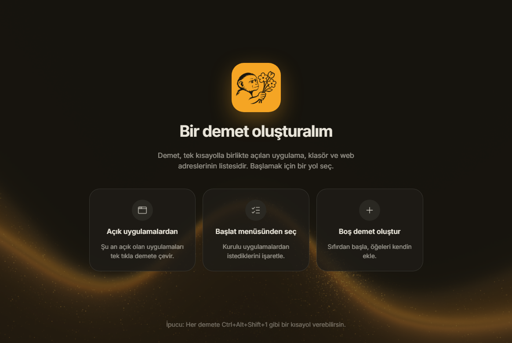

<div align="center">


# Demet

**Birlikte kullandığın uygulamaları, klasörleri ve web sitelerini bir demet altında topla, tek kısayolla aç.**

[](https://github.com/bilikenes/demet/releases/latest)
[](https://github.com/bilikenes/demet/actions/workflows/ci.yml)


[İndir](https://github.com/bilikenes/demet/releases/latest) · [Özellikler](#özellikler) · [Geliştirme](#geliştirme) · [Sürüm çıkarma](RELEASING.md)

</div>

---

<div align="center">
  
</div>

## Demet nedir?

Her sabah aynı editörü, aynı tarayıcı sekmelerini, aynı proje klasörünü ve aynı sohbet uygulamasını tek tek açıyorsan,
Demet tam sana göre. Bunları bir **demet** olarak kaydedersin; bir kısayola basınca hepsi sırayla açılır.

Tauri 2 (Rust) ile yazıldığı için küçük ve hızlıdır. Arka planda tepsiden çalışır, istersen Windows ile birlikte başlar.

## Özellikler

- **Üç tür öğe:** uygulama, klasör ve web adresi aynı demette bir arada durur.
- **Üç yoldan demet oluşturma:** şu an açık olan uygulamalardan tek tıkla, Başlat menüsündeki kurulu uygulamalardan seçerek ya da boş bir demetle sıfırdan.
- **Her demete kendi kısayolu:** örneğin `Ctrl+Alt+Shift+1`.
- **Hızlı menü:** her yerden açılan küçük bir pencere. Kısayolla ya da fare kombinasyonuyla (`Ctrl + orta tuş`, `Alt + orta tuş` ve diğerleri) çıkar, demeti seçip başlatırsın.
- **Akıllı başlatma:** uygulama zaten açıksa yeniden açmak yerine öne getirir. İstersen her seferinde yeni kopya açtırabilirsin.
- **Sıralama ve gecikme:** her öğe için bekleme süresi, argümanlar ve çalışma klasörü ayarlanabilir.
- **Windows ile başlat:** bir demeti oturum açılışında otomatik çalıştır.
- **Tepsi desteği:** pencereyi kapatınca arka planda çalışmaya devam eder, simge durumunda başlayabilir.
- **Açık ve koyu tema**, özel pencere çubuğu ve animasyonlu arka plan.
- **Otomatik güncelleme:** yeni sürümler imza doğrulamasıyla kendiliğinden kurulur.

## Kurulum

[Releases](https://github.com/bilikenes/demet/releases/latest) sayfasından `Demet_x.y.z_x64-setup.exe` dosyasını indirip çalıştır.
Yönetici izni gerekmez. Kurulumdan sonra güncellemeleri uygulama kendisi bulur.

## Kullanım

1. Demet'i aç ve karşılama ekranından bir demet oluştur.
2. Öğeleri ekle, sırala, gerekirse gecikme ve argüman ver.
3. Demete bir kısayol ata.
4. Artık o kısayola bastığında ya da hızlı menüden seçtiğinde demetin tamamı açılır.

> **İpucu:** Ayarlar bölümünden hızlı menünün klavye kısayolunu ve fare kombinasyonunu değiştirebilirsin.

## Geliştirme

Gereksinimler: Node.js, [Rust](https://rustup.rs) ve Tauri 2'nin [Windows ön koşulları](https://tauri.app/start/prerequisites/).

```bash
npm install
npm run tauri:dev     # geliştirme (sıcak yenileme)
npm run tauri:build   # Windows yükleyicisi (NSIS); imza anahtarı gerekir, bkz. RELEASING.md
npm run check:ui      # Amber UI kural denetimi
cd src-tauri && cargo test --lib
```

Yapılandırma `%APPDATA%\Demet\config.json` dosyasında tutulur.

## Görsel kimlik

Demet'in simgesi, çiçek demetini özenle tutan beyaz yüzlü bir kapuçin maymunudur: farklı çiçeklerin tek demette toplanması
uygulamanın işlevini, maymunun becerikli elleri ise seçme ve bir arada tutma eylemini anlatır. Çizim, amber zemin üzerinde
doğal tarih gravürü diliyle hazırlanmıştır.

Simge setleri (`.ico`, Tauri, web ve PNG boyutları) `design/logo/` altındadır.

---

<div align="center">
  <sub>Simgeler: <a href="public/licenses/gravity-ui-icons.txt">Gravity UI Icons</a> lisansı kapsamındadır.</sub>
</div>
